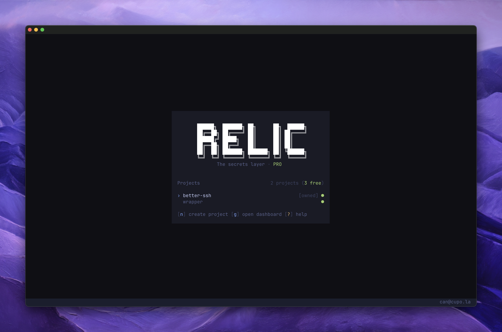

<p align="center">
  <picture>
    <source media="(prefers-color-scheme: dark)" srcset="./apps/web/public/relic-logo-light.svg">
    <source media="(prefers-color-scheme: light)" srcset="./apps/web/public/relic-logo-dark.svg">
    
  </picture>
</p>

<p align="center">
  End-to-end encrypted secrets for developers and AI agents.<br>
  Manage, share, and inject environment variables, encrypted on your device — servers store ciphertext; AI agents see names, with best-effort output redaction.
</p>

<p align="center">
  <a href="https://github.com/heycupola/relic/stargazers"></a>
  <a href="https://github.com/heycupola/relic/blob/canary/LICENSE"></a>
  <a href="https://docs.withrelic.com"></a>
</p>

<p align="center">
  <a href="https://withrelic.com"></a>
</p>

---

### What is Relic?

Relic is a CLI-first, end-to-end encrypted secret manager built for developers, teams, and AI coding workflows.

- **Encrypted on your device:** Secrets are encrypted client-side with AES-256-GCM and Argon2id before leaving your machine. Our servers store only ciphertext.
- **Familiar `.env` workflow, zero plaintext on disk:** Paste `.env` files directly into the TUI editor or import from Doppler, Infisical, Vercel, and 1Password. At runtime, a memory-safe Rust runner injects variables into your process and wipes memory on exit.
- **AI-safe MCP server (`relic mcp`):** Let Cursor, Claude Code, Codex, and Zed inspect secret names and run commands with secrets injected while values are best-effort redacted from output (env dumps blocked by default).
- **Direct platform sync (`relic push`):** Decrypt locally and sync straight to Vercel, Cloudflare Workers, GitHub Actions, Fly.io, and more with diff plans (`+`, `~`, `-`).
- **Shift-left protection (`relic guard` & `relic check`):** Block accidental `.env` or secret leaks in pre-commit hooks, and validate missing keys in your IDE or CI.
- **Encrypted team sharing & OIDC CI/CD:** Share projects using per-collaborator public keys, and run pipelines with passwordless OIDC service accounts.

### Install — try Relic in ~60 seconds

macOS / Linux:

```bash
curl -fsSL https://withrelic.com/install | bash
relic login
relic init
relic          # TUI: create environment "development", add a secret name
relic run -e development -- echo ok
```

Windows (PowerShell):

```powershell
irm https://withrelic.com/install.ps1 | iex
relic login
relic init
relic run -e development -- echo ok
```

Alternates: `brew install heycupola/tap/relic` · `npm install -g relic` · `bun add -g relic`

Prebuilt binaries are also available on the [releases page](https://github.com/heycupola/relic/releases).

### Quick Start

```bash
relic login                                    # Authenticate via browser
relic init                                     # Link your project (creates relic.toml)
relic import -e development                    # Import from .env, Doppler, Infisical, or 1Password
relic                                          # Open the TUI to edit and organize secrets
relic run -e production -- npm run deploy      # Run any command with secrets injected
relic push -e production --target vercel       # Sync directly to Vercel, Cloudflare, GitHub, or Fly
```

### Use with AI Agents (MCP)

Add Relic to Cursor, Claude Code, Codex, or Zed so your AI assistant can run tests and scripts without reading a `.env` file:

```bash
claude mcp add relic -- relic mcp
```

### How It Works

Relic encrypts and decrypts secrets on your device using AES-256-GCM, RSA-OAEP-2048, and Argon2id. The server only stores ciphertext.

When you run `relic run` or `relic shell`, the CLI fetches encrypted secrets, decrypts them locally, and injects them into the target process through a native Rust runner that zeroes memory after use. No secrets are ever written to disk.

Learn more in the [documentation](https://docs.withrelic.com).

### Contributing

If you're interested in contributing to Relic, please read our [contributing guide](./CONTRIBUTING.md) before submitting a pull request.

For security issues, email [can@withrelic.com](mailto:can@withrelic.com) directly. Do not open public issues.

---

[Website](https://withrelic.com) | [Documentation](https://docs.withrelic.com) | [Changelog](https://withrelic.com/changelog) | [Discord](https://discord.gg/2vNRzRMY6K) | [X](https://x.com/icanvardar)
